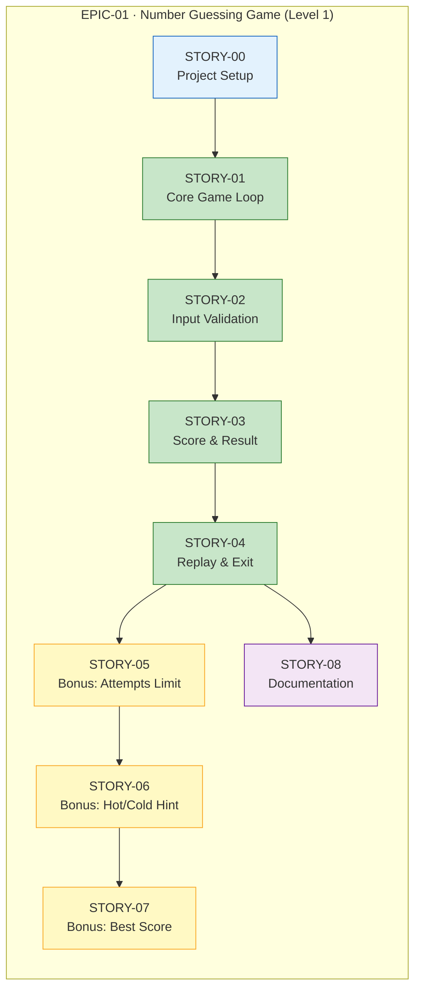

# 🎫 Level 1 — Backlog (Tickets)

> Project: `level-01-guessing-game/`
> Format: Agile-style backlog · Ready to paste into GitHub Issues / Jira / Linear / Trello
> Sizing: **XS** (<30 min) · **S** (30–60 min) · **M** (1–2h) · **L** (2–4h)

---

## 📊 Backlog Overview (Mermaid)



---

## 🎯 EPIC

**EPIC-01 · Number Guessing Game**
Level 1 capstone project. A CLI game where the player guesses a random 1–100 number with hints, attempt tracking, and replay. Uses only Python stdlib.

**Definition of Done (Epic):**
- [ ] All Must tickets closed
- [ ] Manual test matrix (T01–T09) passes
- [ ] README written
- [ ] Merged to `main` and tagged `level-01-done`

---

## 📋 Stories & Tickets

---

### 🧱 STORY-00 — Project Setup
**Type:** chore · **Priority:** P0 · **Estimate:** XS
**Description:** Scaffold the level-01 folder and base files so development can start.
**Acceptance Criteria:**
- [ ] `level-01-guessing-game/` folder exists in monorepo
- [ ] `main.py` created with header comment (project name, author, date)
- [ ] `README.md` created with title + "How to run" section (placeholder)
- [ ] `.gitignore` at repo root ignores `__pycache__/`, `*.pyc`, `.venv/`

**Tickets:**
- `T-00.1` · Create folder + `main.py` skeleton
- `T-00.2` · Create `README.md` placeholder
- `T-00.3` · Verify `.gitignore` covers Python artifacts

**Labels:** `chore`, `setup`
**Definition of Done:** `python main.py` runs and prints a placeholder line without errors.

---

### 🎮 STORY-01 — Core Game Loop
**Type:** feature · **Priority:** P0 · **Estimate:** M
**Description:** As a player, I want to play a round where the computer picks a number and I can guess until I'm correct, so the game is playable end-to-end.
**Acceptance Criteria:**
- [ ] Secret number generated with `random.randint(1, 100)`
- [ ] Player is prompted for a guess in a loop
- [ ] Correct guess ends the round with a success message
- [ ] `check_guess()` returns `"correct"`, `"too high"`, or `"too low"` (pure function)
- [ ] `print_intro()` shows game title and rules

**Tickets:**
- `T-01.1` · Implement `random_number()` using `random.randint`
- `T-01.2` · Implement `check_guess(guess, secret)` pure function
- `T-01.3` · Implement `print_intro()` banner
- `T-01.4` · Implement `play_round()` with `while` loop and hint output
- `T-01.5` · Wire `main()` → `print_intro()` → `play_round()`

**Labels:** `feature`, `core`, `must`
**Definition of Done:** Player can play one round to completion (guessing correctly).

---

### 🛡️ STORY-02 — Input Validation
**Type:** feature · **Priority:** P0 · **Estimate:** S
**Description:** As a player, I want invalid input (letters, out of range, empty) handled gracefully so the game never crashes.
**Acceptance Criteria:**
- [ ] `"abc"` → prints "Please enter a number." and re-prompts
- [ ] `"0"`, `"101"`, `"-5"` → prints "Enter a number between 1 and 100." and re-prompts
- [ ] Empty string → re-prompts
- [ ] Whitespace around a number is trimmed (e.g., `" 42 "` works)
- [ ] Typing `q` (case-insensitive) exits the round gracefully (returns `None`)
- [ ] No `ValueError` or `TypeError` ever surfaces to the player

**Tickets:**
- `T-02.1` · Implement `validate_input(raw)` returning `int | None`
- `T-02.2` · Implement `get_guess(attempt, max_attempts)` loop with re-prompt
- `T-02.3` · Handle `q` / `Q` quit signal inside `get_guess`
- `T-02.4` · Manual test T04–T06 pass

**Labels:** `feature`, `robustness`, `must`
**Definition of Done:** All invalid-input cases from test matrix handled without crash.

---

### 🏆 STORY-03 — Score & Result Display
**Type:** feature · **Priority:** P0 · **Estimate:** S
**Description:** As a player, I want to see how many attempts I took and a final message so I know how I did.
**Acceptance Criteria:**
- [ ] Attempt counter increments on each **valid** guess only
- [ ] On correct: shows "You guessed it in N attempts."
- [ ] Attempt count is printed on win
- [ ] `print_result(attempts, won, secret, best)` prints final message

**Tickets:**
- `T-03.1` · Track `attempts` counter in `play_round()`
- `T-03.2` · Implement `print_result()` for win case
- `T-03.3` · Ensure invalid guesses do NOT increment attempts
- `T-03.4` · Manual test T01–T03 pass

**Labels:** `feature`, `must`
**Definition of Done:** Correct guess prints attempt count and celebration message.

---

### 🔁 STORY-04 — Replay & Exit
**Type:** feature · **Priority:** P0 · **Estimate:** S
**Description:** As a player, I want to replay or quit without restarting the script so the experience is smooth.
**Acceptance Criteria:**
- [ ] After round, prompt "Play again? (y/n):"
- [ ] `y` / `Y` starts a new round (new secret number)
- [ ] `n` / `N` exits with "Thanks for playing!"
- [ ] Any other input re-prompts
- [ ] Exiting ends the program with exit code 0

**Tickets:**
- `T-04.1` · Implement `ask_replay()` returning `bool`
- `T-04.2` · Loop `play_round()` in `main()` until replay returns `False`
- `T-04.3` · Manual test T08–T09 pass

**Labels:** `feature`, `must`
**Definition of Done:** Player can complete two rounds back-to-back and exit cleanly.

---

### 🎚️ STORY-05 — Bonus: Attempts Limit
**Type:** feature · **Priority:** P1 · **Estimate:** S
**Description:** As a player, I want a 7-attempt cap so the game has a win/lose challenge.
**Acceptance Criteria:**
- [ ] `MAX_ATTEMPTS = 7` constant
- [ ] After 7 wrong guesses, round ends with "You lost. The number was X."
- [ ] Win case still shows attempt count
- [ ] Prompt shows "Attempt N/7"

**Tickets:**
- `T-05.1` · Add `MAX_ATTEMPTS` constant
- `T-05.2` · Enforce limit in `play_round()`
- `T-05.3` · Implement lose-case in `print_result()`
- `T-05.4` · Manual test T07 pass

**Labels:** `bonus`, `gameplay`
**Definition of Done:** 7 wrong guesses ends round and reveals secret.

---

### 🔥 STORY-06 — Bonus: Hot/Cold Hint
**Type:** feature · **Priority:** P2 · **Estimate:** S
**Description:** As a player, I want a distance hint (very close / close / far) so I get more engaging feedback.
**Acceptance Criteria:**
- [ ] `hot_cold(guess, secret)` returns hint string
- [ ] Distance ≤ 5 → "🔥 very close"
- [ ] Distance ≤ 15 → "🌤 close"
- [ ] Else → "❄️ far"
- [ ] Hint printed alongside "too high"/"too low"

**Tickets:**
- `T-06.1` · Add `HOT_THRESHOLD`, `WARM_THRESHOLD` constants
- `T-06.2` · Implement `hot_cold()`
- `T-06.3` · Print hint in `play_round()`

**Labels:** `bonus`, `ux`
**Definition of Done:** Hint displayed on each wrong guess.

---

### 🥇 STORY-07 — Bonus: Best Score (Session)
**Type:** feature · **Priority:** P2 · **Estimate:** XS
**Description:** As a player, I want my best score tracked in the session so replay feels competitive.
**Acceptance Criteria:**
- [ ] `best` tracked in `main()` scope
- [ ] On new best win: prints "New best score!"
- [ ] On exit: prints best score if any
- [ ] Persistence NOT required (Level 3 adds files)

**Tickets:**
- `T-07.1` · Track `best` across rounds in `main()`
- `T-07.2` · Print best score on exit

**Labels:** `bonus`, `gameplay`
**Definition of Done:** After 2+ rounds, exit prints best score.

---

### 📖 STORY-08 — Documentation
**Type:** docs · **Priority:** P1 · **Estimate:** S
**Description:** As a future me (or a reviewer), I want a README so the project is usable and understandable.
**Acceptance Criteria:**
- [ ] `README.md` in `level-01-guessing-game/`
- [ ] Contains: project title, what it does, how to run, example output
- [ ] Contains: "What I learned" section (3 bullets)
- [ ] Root `README.md` progress table updated: Level 1 → ✅

**Tickets:**
- `T-08.1` · Write level README (title, run, example, learnings)
- `T-08.2` · Update root progress table to ✅

**Labels:** `docs`
**Definition of Done:** README is complete and root tracker updated.

---

## 🗂️ Backlog Board View (Mermaid Kanban)

```mermaid
kanban
    Backlog
        T-05.1 Add MAX_ATTEMPTS constant
        T-06.1 Add threshold constants
        T-07.1 Track best in main
    Ready
        T-01.1 random_number()
        T-01.2 check_guess()
        T-02.1 validate_input()
    In Progress
        T-00.1 Create folder + main.py
    Review
        T-01.3 print_intro()
    Done
        T-00.2 README placeholder
        T-00.3 .gitignore check
```

---

## 🧪 QA Test Matrix (linked to tickets)

| ID | Linked Story | Input | Expected | Status |
|----|--------------|-------|----------|--------|
| T01 | STORY-01 | secret=42, guess=42 | "correct" | ⬜ |
| T02 | STORY-01 | secret=42, guess=50 | "too high" | ⬜ |
| T03 | STORY-01 | secret=42, guess=10 | "too low" | ⬜ |
| T04 | STORY-02 | input `"abc"` | re-prompt, no crash | ⬜ |
| T05 | STORY-02 | input `"0"` | re-prompt, out of range | ⬜ |
| T06 | STORY-02 | input `"q"` | exits round gracefully | ⬜ |
| T07 | STORY-05 | 7 wrong guesses | "you lost", reveals secret | ⬜ |
| T08 | STORY-04 | replay `"Y"` | new round starts | ⬜ |
| T09 | STORY-04 | replay `"n"` | program exits | ⬜ |

---

## 🏷️ Labels & Conventions

| Label | Meaning |
|-------|---------|
| `must` | P0 — required for DoD |
| `bonus` | P1/P2 — nice to have |
| `feature` | New functionality |
| `chore` | Setup / non-feature |
| `docs` | Documentation |
| `robustness` | Error handling |
| `gameplay` | Game mechanics |
| `ux` | Player-facing polish |

**Ticket ID format:** `T-<story>.<n>` (e.g., `T-02.3`)
**Branch name format:** `feat/level-01-T-02.3-quit-signal`
**Commit format:** `level-01: add q quit signal (T-02.3)`

---

## 🚦 Suggested Execution Order

```mermaid
gantt
    title Level 1 Execution Plan
    dateFormat  HH:mm
    axisFormat  %H:%M

    section Setup
    STORY-00 Project Setup        :a1, 00:00, 20m

    section MVP
    STORY-01 Core Game Loop       :a2, after a1, 90m
    STORY-02 Input Validation     :a3, after a2, 45m
    STORY-03 Score & Result       :a4, after a3, 30m
    STORY-04 Replay & Exit        :a5, after a4, 30m

    section Bonus
    STORY-05 Attempts Limit       :a6, after a5, 30m
    STORY-06 Hot/Cold Hint        :a7, after a6, 20m
    STORY-07 Best Score           :a8, after a7, 15m

    section Wrap-up
    STORY-08 Documentation        :a9, after a8, 30m
```



**Total estimate:** ~5 hours (MVP ~3.5h · Bonus ~1h · Docs ~30m)

---

## ✅ Epic Completion Checklist

- [ ] STORY-00 → STORY-08 all tickets closed
- [ ] QA test matrix T01–T09 all ✅
- [ ] No `TODO` comments left in `main.py`
- [ ] `python main.py` runs cleanly on a fresh terminal
- [ ] README complete
- [ ] Committed and merged to `main`
- [ ] Tag created: `git tag level-01-done`

---

## 📤 How to use this backlog

**Option A — GitHub Issues (recommended)**
1. Create an issue per **Story** with the tickets as a checklist.
2. Add labels from the table above.
3. Use a GitHub Project board with columns: Backlog → Ready → In Progress → Review → Done.

**Option B — Plain markdown**
1. Copy this file to `level-01-guessing-game/BACKLOG.md`.
2. Tick checkboxes as you go.
3. Commit after each story.

**Option C — Simple text file**
```
[ ] T-00.1 Create folder + main.py skeleton
[ ] T-00.2 Create README.md placeholder
...
```

---

