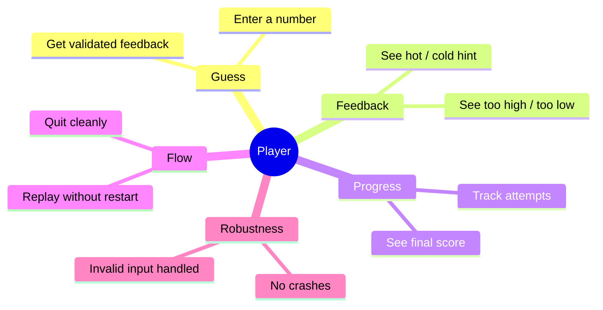
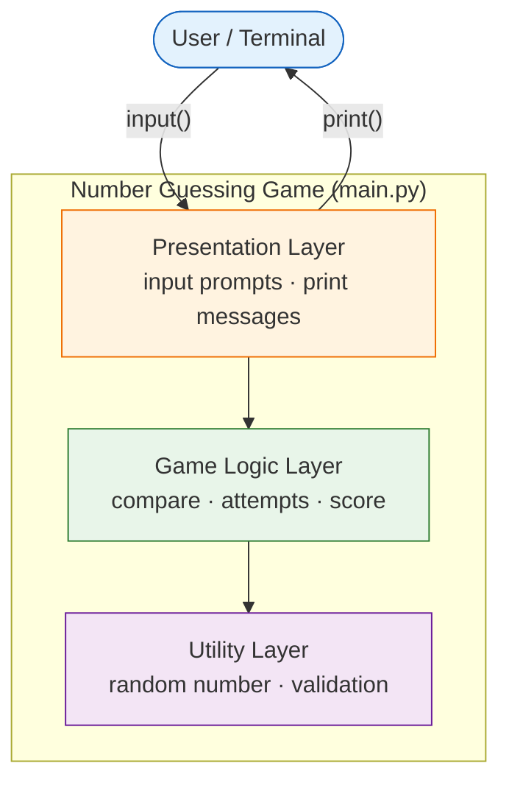
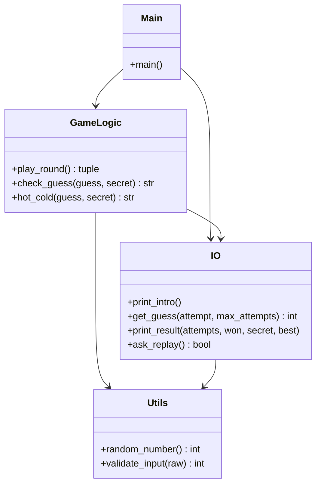
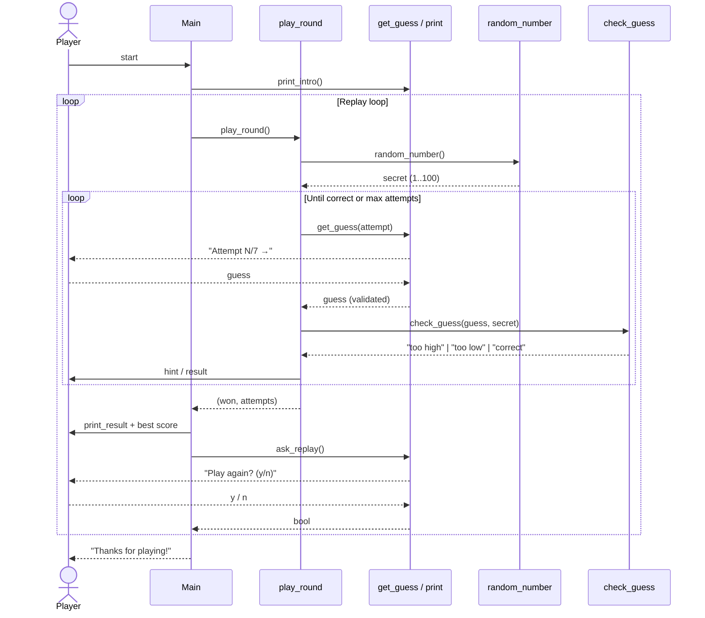
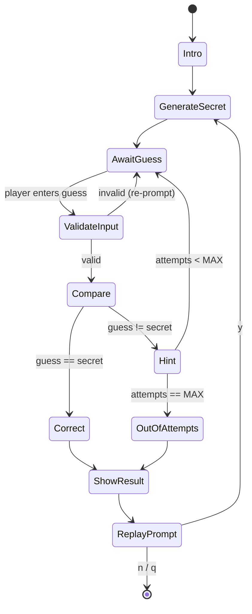
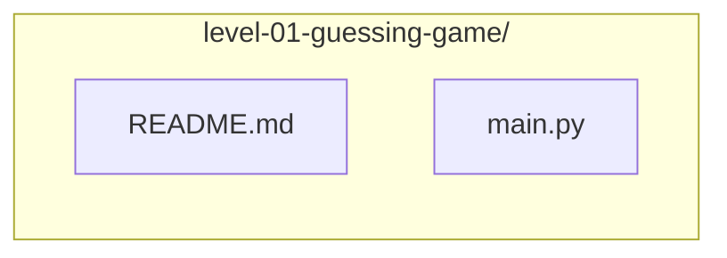
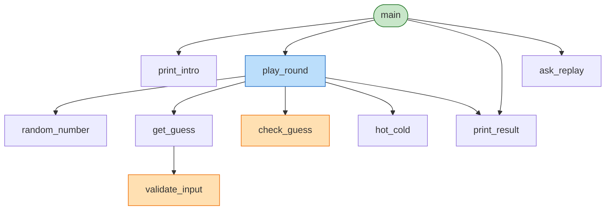
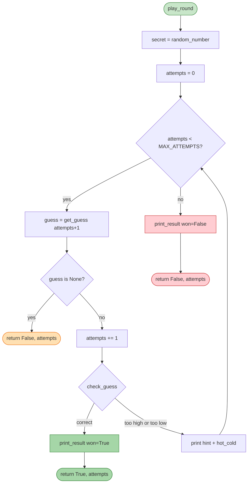
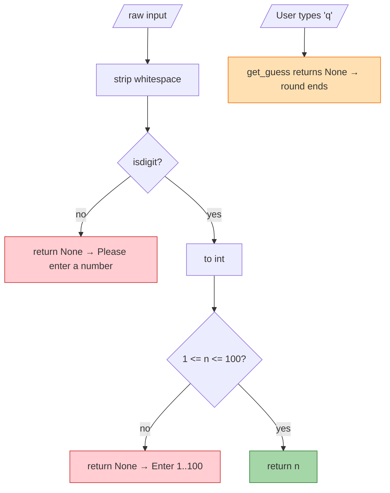
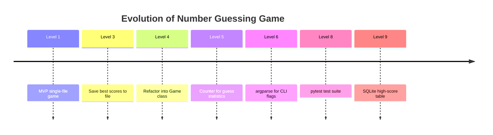

# 📘 Level 1 — Number Guessing Game
## Full Documentation Pack: PRD · SRS · HLD · LLD (with Mermaid Diagrams)

> Project: `level-01-guessing-game/`
> Level: 1 — Absolute Beginner (Syntax & Basics)
> Stack: Python 3.10+ · Standard library only

---

# 1. 📄 PRD — Product Requirements Document

## 1.1 Overview
A terminal-based **Number Guessing Game** where the player tries to guess a random number between 1 and 100. Each guess receives feedback ("too high" / "too low"), and the game tracks attempts and score.

## 1.2 Purpose
Serve as the **Level 1 capstone project** for a Python learning journey — practicing variables, data types, conditionals, loops, input/output, and basic functions.

## 1.3 Target User
- Primary: A beginner Python learner (the developer themselves).
- Secondary: Anyone who wants a quick CLI game.

## 1.4 Goals
| Goal | Success Metric |
|------|----------------|
| Practice core syntax | Uses `input`, `print`, `if/else`, `while`, `random` |
| Working game | Game runs start-to-finish without crashing on valid input |
| Graceful errors | Invalid input does not crash the program |
| Replayability | Player can replay without restarting the script |

## 1.5 Non-Goals (out of scope)
- No GUI
- No database / persistence
- No multiplayer
- No network features

## 1.6 Features (MVP)
1. Generate a random number 1–100.
2. Accept user guesses.
3. Give "too high" / "too low" / "correct" feedback.
4. Count attempts.
5. Print final score.
6. Replay option.

## 1.7 Bonus Features (optional)
- Limit to **7 attempts** → win/lose.
- Show a "hot/cold" hint based on distance.
- Keep a high-score list (in memory only).

## 1.8 User Stories



## 1.9 Acceptance Criteria
- [ ] Number is always between 1 and 100 inclusive.
- [ ] Non-numeric input prints an error and re-prompts (does not crash).
- [ ] Out-of-range input is rejected.
- [ ] "Correct" ends the round and shows attempt count.
- [ ] Replay prompt accepts `y/n` (case-insensitive).
- [ ] Program exits cleanly on `n` or `q`.

## 1.10 Success Definition (Definition of Done)
The game runs, all acceptance criteria pass, README written, committed to `level-01-guessing-game/`.

---

# 2. 📑 SRS — Software Requirements Specification

## 2.1 Introduction
This SRS defines functional and non-functional requirements for the Number Guessing Game (NGG), v1.0.

## 2.2 Scope
A single-user, single-process CLI game using only the Python standard library.

## 2.3 Definitions
| Term | Meaning |
|------|---------|
| Round | One complete game from number-generation to correct guess or out of attempts |
| Attempt | A single guess submitted by the player |
| Secret number | The randomly generated target (1–100) |

## 2.4 Functional Requirements

| ID   | Requirement                                                  | Risk   | Verify Method |
|------|--------------------------------------------------------------|--------|---------------|
| FR01 | Generate random integer in 1 to 100                          | low    | test          |
| FR02 | Prompt player to enter a guess                               | low    | test          |
| FR03 | Validate input is an integer                                 | medium | test          |
| FR04 | Reject out of range input with a message                     | medium | test          |
| FR05 | Compare guess and output too high, too low, or correct       | low    | test          |
| FR06 | Increment attempt counter on each valid guess                | low    | test          |
| FR07 | Display attempt count and score on correct guess             | low    | test          |
| FR08 | Prompt to replay y or n                                      | low    | test          |
| FR09 | Exit cleanly when player declines or types q                 | low    | test          |
| FR10 | Enforce 7 attempt limit in bonus mode                        | low    | test          |
## 2.5 Non-Functional Requirements

| ID | Requirement |
|----|-------------|
| NFR-01 | Runs on Python 3.10+ |
| NFR-02 | Standard library only (`random`) |
| NFR-03 | No crash on any user input (invalid input handled) |
| NFR-04 | Response time < 100 ms per guess |
| NFR-05 | Code readable: functions, docstrings, ≤ 100 lines for `main.py` |
| NFR-06 | PEP 8 compliant |

## 2.6 External Interface Requirements
- **User interface:** CLI via `input()` / `print()`.
- **Hardware:** None special.
- **Software:** Python 3.10+.

## 2.7 Assumptions & Constraints
- Single user at a time.
- Terminal supports UTF-8 (for emoji/hints, optional).
- No persistent storage in v1.0.

---

# 3. 🏗️ HLD — High-Level Design

## 3.1 Architecture Overview
A **single-process, single-file CLI application** with a simple layered structure.



## 3.2 Main Components



| Component | Responsibility |
|-----------|----------------|
| `main()` | Entry point; runs the game loop and replay logic |
| `play_round()` | Runs one full round |
| `get_guess()` | Prompts and validates input |
| `check_guess()` | Compares guess to secret, returns result |
| `validate_input()` | Ensures input is a valid integer in range |
| `random_number()` | Generates the secret number |
| `print_result()` | Prints final outcome and score |

## 3.3 Data Flow



## 3.4 Control Flow (State Diagram)



## 3.5 Technology Choices
- **Language:** Python 3.10+
- **Libraries:** `random` (stdlib)
- **Interface:** CLI

## 3.6 Design Principles
- **Separation of concerns:** input/output separate from game logic.
- **Testability:** pure functions where possible (`check_guess`, `validate_input`).
- **Extensibility:** easy to add difficulty levels, persistence later.

## 3.7 Key Decisions
| Decision | Rationale |
|----------|-----------|
| Single file `main.py` | Level 1 — avoid overengineering |
| Functions over classes | OOP is Level 4; keep it simple |
| Random 1–100 | Standard game range |
| Attempt limit as toggle | Teaches conditional game modes |

---

# 4. 🔬 LLD — Low-Level Design

## 4.1 Module Structure



### `main.py` — Layout
```
1. Imports
2. Constants
3. Helper functions
     - validate_input()
     - get_guess()
     - check_guess()
     - hot_cold()
     - random_number()
     - print_intro()
     - print_result()
     - ask_replay()
4. Core functions
     - play_round()
     - main()
5. Entry point
```

## 4.2 Constants

```python
MIN_NUMBER    = 1
MAX_NUMBER    = 100
MAX_ATTEMPTS  = 7          # bonus mode
HOT_THRESHOLD = 5
WARM_THRESHOLD= 15
```

## 4.3 Function Call Graph



## 4.4 Functions — Signatures & Contracts

### `random_number() -> int`
Returns a random integer in `[MIN_NUMBER, MAX_NUMBER]`.

### `validate_input(raw: str) -> int | None`
- Trims whitespace.
- Returns `int` if valid integer in range.
- Returns `None` otherwise (caller handles message).

### `get_guess(attempt: int, max_attempts: int | None) -> int | None`
- Prints prompt (shows attempt count if a limit exists).
- Loops until valid input **or** returns `None` if user types `q`.
- Uses `validate_input`.

### `check_guess(guess: int, secret: int) -> str`
Returns one of: `"correct"`, `"too high"`, `"too low"`. Pure function — easily unit-testable.

### `hot_cold(guess: int, secret: int) -> str`
Returns `"🔥 very close"`, `"🌤 close"`, or `"❄️ far"` based on absolute distance.

### `print_intro() -> None`
Prints welcome banner and rules.

### `print_result(attempts: int, won: bool, secret: int, best: int | None) -> None`
Prints final message and score.

### `ask_replay() -> bool`
Prompts `"Play again? (y/n): "`, returns `True`/`False`.

### `play_round() -> tuple[bool, int]`
Runs one round. Returns `(won, attempts)`.

### `main() -> None`
Entry point: `print_intro()` → loop `play_round()` + `ask_replay()` → exit message.

## 4.5 Pseudocode

### `main()`
```
best = None
print_intro()
while True:
    won, attempts = play_round()
    if won and (best is None or attempts < best):
        best = attempts
        print("New best score!")
    if not ask_replay():
        print("Thanks for playing!")
        break
```

### `play_round()`
```
secret = random_number()
attempts = 0
while attempts < MAX_ATTEMPTS:
    guess = get_guess(attempts + 1, MAX_ATTEMPTS)
    if guess is None:            # user quit
        return (False, attempts)
    attempts += 1
    result = check_guess(guess, secret)
    if result == "correct":
        print_result(attempts, True, secret, None)
        return (True, attempts)
    print(f"  {result}")         # + hot_cold hint (bonus)
print_result(attempts, False, secret, None)
return (False, attempts)
```

### `validate_input(raw)`
```
raw = raw.strip()
if not raw.isdigit(): return None        # handles negatives, letters
value = int(raw)
if value < MIN_NUMBER or value > MAX_NUMBER: return None
return value
```

### `check_guess(guess, secret)`
```
if guess == secret: return "correct"
return "too high" if guess > secret else "too low"
```

## 4.6 Internal Flow of `play_round()` (detailed)



## 4.7 Data Model

No persistence. In-memory only:

| Variable | Type | Scope | Purpose |
|----------|------|-------|---------|
| `secret` | int | `play_round` | target number |
| `attempts` | int | `play_round` | guesses made |
| `guess` | int | `play_round` | current guess |
| `best` | int \| None | `main` | best score this session |
| `won` | bool | `main` | outcome of round |

## 4.8 Error Handling



| Case | Handling |
|------|----------|
| Non-numeric input (`"abc"`) | `validate_input` returns `None` → message "Please enter a number." |
| Out of range (`0`, `101`, `-5`) | `validate_input` returns `None` → "Enter a number between 1 and 100." |
| User types `q` | `get_guess` returns `None` → round ends gracefully |
| Attempts exhausted | Round ends, reveal secret, show result |

## 4.9 Example Run (Screenshot-style)

```
========================================
   🎯 Guess the Number (1–100)
   You have 7 attempts. Type 'q' to quit.
========================================
Attempt 1/7 → 50
  too high ❄️ far
Attempt 2/7 → 25
  too low 🌤 close
Attempt 3/7 → 37
  too high 🔥 very close
Attempt 4/7 → 33
  correct! 🎉
You guessed it in 4 attempts.
Play again? (y/n): n
Thanks for playing! Best score: 4
```

## 4.10 Test Cases (manual, Level 1 — `pytest` comes at Level 8)

| ID | Input | Expected |
|----|-------|----------|
| T01 | secret=42, guess=42 | "correct" |
| T02 | secret=42, guess=50 | "too high" |
| T03 | secret=42, guess=10 | "too low" |
| T04 | input `"abc"` | re-prompt, no crash |
| T05 | input `"0"` | re-prompt, out of range |
| T06 | input `"q"` | exits round gracefully |
| T07 | 7 wrong guesses | "you lost", reveals secret |
| T08 | replay `"Y"` | new round starts |
| T09 | replay `"n"` | program exits |

## 4.11 Future Extensions (mapped to later levels)



| Extension | Level |
|-----------|-------|
| Save best scores to a file | Level 3 |
| Refactor into a `Game` class | Level 4 |
| Add a `Counter` for guess stats | Level 5 |
| Add `argparse` for `--max-attempts`, `--range` | Level 6 |
| Unit tests with `pytest` | Level 8 |
| SQLite high-score table | Level 9 |

## 4.12 Definition of Done (LLD level)
- [ ] `main.py` implements all functions above.
- [ ] All 9 manual test cases pass.
- [ ] Docstrings on every function.
- [ ] `README.md` in folder explains how to run.
- [ ] Committed to `level-01-guessing-game/`.

---


